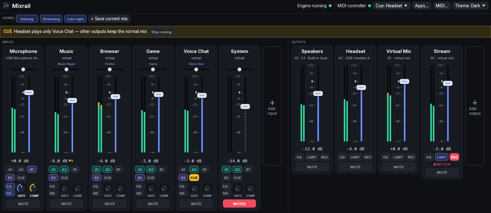
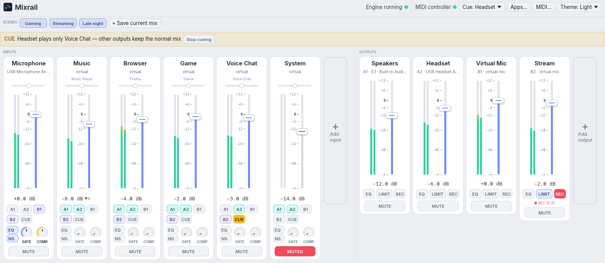
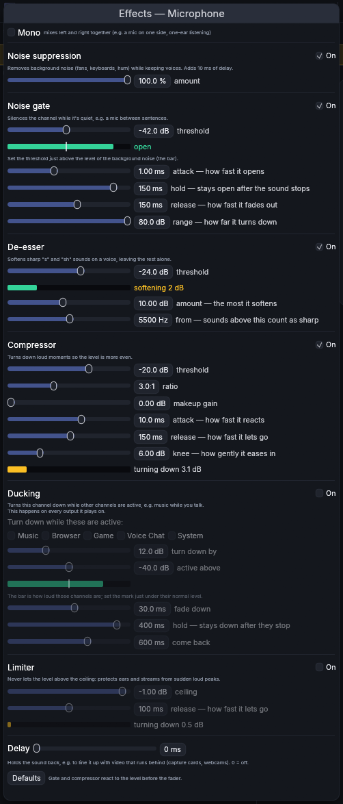
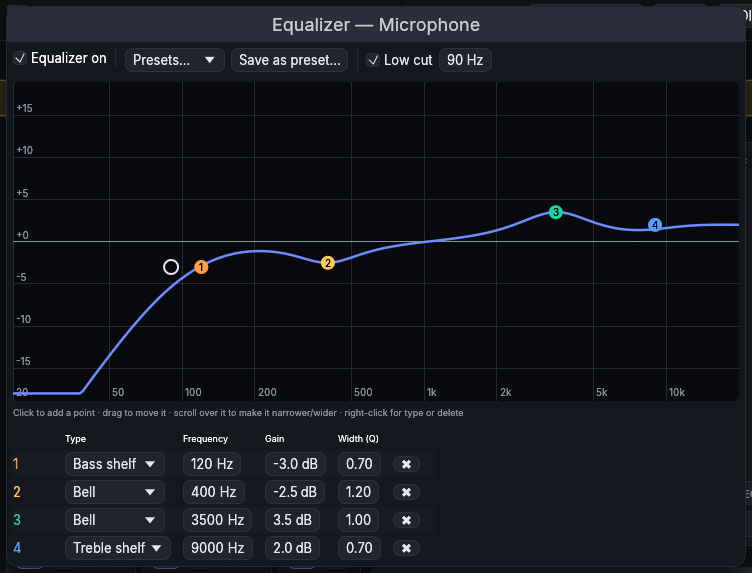
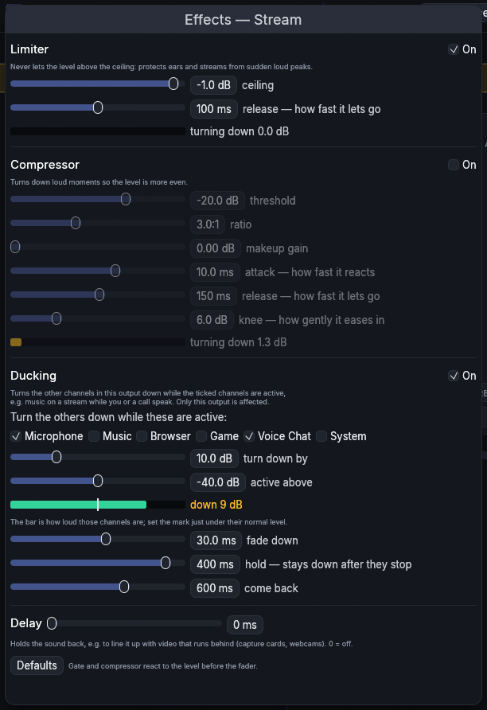
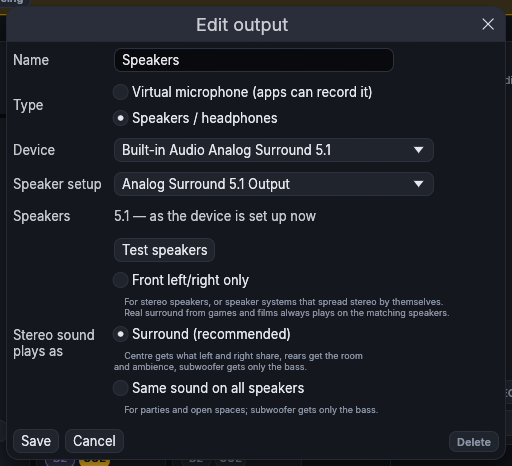
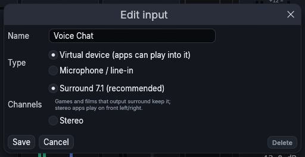
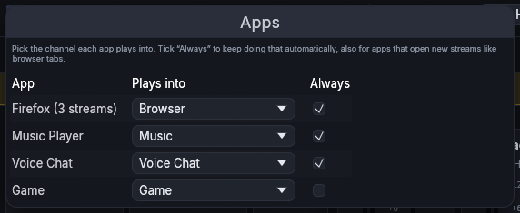
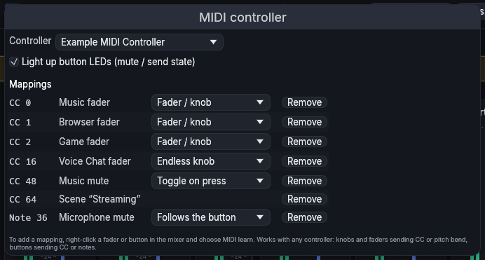

# Mixrail — Linux Audio Mixer

**Mixrail is a virtual audio mixer for Linux**, built on PipeWire: an alternative for
people who know Voicemeeter from Windows. Give every app its own channel, mix them onto your speakers,
headphones and virtual microphones, add effects like noise suppression to your mic, and
control it all from the window or a MIDI controller.



*Inputs on the left, outputs on the right. Every input has a fader with level meter,
balance, buttons for the outputs it plays on (A1, A2, B1, B2…), cue, effects and mute.*

<details>
<summary>Light theme</summary>



</details>

## Contents

- [What it does](#what-it-does)
- [Installation](#installation)
- [Getting started](#getting-started)
- [Using the mixer](#using-the-mixer)
- [MIDI controllers](#midi-controllers)
- [Desktops](#desktops)
- [Configuration file](#configuration-file)
- [How it works](#how-it-works)
- [Roadmap](#roadmap)
- [Development](#development)
- [Settings guide (with screenshots)](#settings-guide)

## What it does

- **Inputs (strips)**: virtual devices that apps play into (e.g. "Music", "Browser",
  "Voice Chat"), or physical inputs like a microphone.
- **Outputs (buses)**: your speakers and headphones, or virtual microphones that other
  apps (Discord, OBS, Zoom) can record.
- **Any number of each**, added, edited and removed in the window. Nothing is hardcoded.
- **Routing**: send any input to any combination of outputs with one click.
- **Per-app routing**: pick the channel for each app, and tick "Always" to remember it.
  Also works for apps that open a new stream per tab or per song (browsers).
- **Effects, built in** (no plugins needed): noise suppression, noise gate, de-esser,
  equalizer with a graph, compressor, limiter, ducking, low cut, mono, balance and delay.
- **Surround**: virtual inputs are 7.1, so games and films keep their surround sound;
  every output adapts to its speakers (5.1, stereo headphones…), can spread stereo music
  over surround speakers, and you can switch the sound card's speaker setup in the app.
- **Scenes**: save the whole mix and switch back with one click or a MIDI button.
- **Cue**: listen to one channel on your headphones without changing what others hear.
- **Recording**: record any output to a FLAC file with one click.
- **MIDI controllers**: any controller works (faders, knobs, endless encoders, buttons,
  pads, motorised faders), with MIDI learn and button LEDs that follow the mixer.
- **Reliable**: it heals itself when devices are unplugged, apps restart or PipeWire
  restarts, and audio keeps flowing even if the mixer itself stops.
- **Any desktop**: GNOME, KDE Plasma, XFCE, Cinnamon and more, on Wayland or X11, with
  an optional tray icon.

## Installation

Mixrail needs **PipeWire**, the standard sound system on current Linux distributions
(Fedora, Ubuntu 22.10+, Debian 12+, Arch, openSUSE, Pop!_OS, CachyOS…). To check:
`pactl info | grep "Server Name"` should mention PipeWire.

### With a package manager

| Distribution | How |
|---|---|
| **Arch, CachyOS, Manjaro, EndeavourOS** | Download the `.pkg.tar.zst` from the [latest release](https://github.com/thunderthome/mixrail/releases/latest), then `sudo pacman -U ./mixrail-*.pkg.tar.zst`. Or build it: `git clone https://github.com/thunderthome/mixrail && cd mixrail/packaging/aur && makepkg -si`. (Coming to the AUR as `mixrail`.) |
| **Ubuntu 24.04+, Debian 13+, Linux Mint 22+, Pop!_OS 24.04+** | Download the `.deb` from the [latest release](https://github.com/thunderthome/mixrail/releases/latest), then `sudo apt install ./mixrail_*.deb` (or double-click it) |
| **Fedora** (44 and newer) | `sudo dnf copr enable thunderthome/mixrail` then `sudo dnf install mixrail`; updates arrive with your normal system updates. (Or download the `.rpm` from the [latest release](https://github.com/thunderthome/mixrail/releases/latest).) |

Then open **Mixrail** from your app menu. The first time, it starts its engine and sets it
to start at every login; the tray icon appears from the next login on desktops that have
a tray.

### From source

For other distributions, older versions of the ones above, or the newest development version. Install the build tools (Rust 1.88 or
newer, PipeWire and ALSA development files):

| Distribution | Command |
|---|---|
| Arch, CachyOS, Manjaro | `sudo pacman -S rust clang pkgconf pipewire alsa-lib` |
| Fedora | `sudo dnf install cargo clang-devel pkgconf pipewire-devel alsa-lib-devel` |
| Debian, Ubuntu, Mint | `sudo apt install clang libclang-dev pkg-config libpipewire-0.3-dev libasound2-dev` and Rust from [rustup.rs](https://rustup.rs) |
| openSUSE | `sudo zypper install rust cargo clang-devel pkgconf pipewire-devel alsa-devel` |

Then, in the source folder:

```sh
packaging/install.sh
```

This builds Mixrail, installs it for your user in `~/.local` (no root needed), adds it to
the app menu and the tray, and starts the engine at login (with systemd, or through the
desktop's autostart without it). Run it again to update; `packaging/install.sh --no-tray`
leaves out the tray icon and `packaging/install.sh --uninstall` removes Mixrail again
(your settings stay in `~/.config/mixrail`).

## Getting started

1. Open **Mixrail** from the app menu. On first start the engine creates a
   starter layout from your current default devices.
2. **Add inputs** with the "+ Add input" card: a *virtual device* for each group of apps
   (Music, Browser, Games, Voice Chat…), and a *microphone* for your mic.
3. **Add outputs** with "+ Add output": your speakers and headphones, and a *virtual
   microphone* for each app that should hear a mix (e.g. one for Discord, one for OBS).
4. **Route**: on each input, click the buttons of the outputs it should play on. A buttons
   are speakers/headphones, B buttons are virtual microphones.
5. **Send apps to channels**: click "Apps…" at the top, pick the channel for each app and
   tick "Always". Virtual inputs also show up in your desktop's sound settings and in every
   app's audio output menu, so you can pick them there too.
6. In Discord/OBS/Zoom, choose the virtual microphone (e.g. "Virtual Mic") as the input.

## Using the mixer

### The main window

| Control | What it does |
|---|---|
| **Name** (top of a card) | Click to edit, change the device or delete the channel. |
| **Blue text** under the name | The apps playing into this channel now; click it to open the Apps window. |
| **Balance** (small slider) | Left/right balance. Double-click for centre. |
| **Fader** | Volume, from off to +12 dB. Drag or scroll; double-click for 0 dB. The meter beside it shows the level. |
| **A1, A2, B1…** | Which outputs this input plays on. |
| **CUE** | Listen to this channel on the cue output (see [Cue](#cue)). |
| **EQ** | Opens the equalizer. |
| **NS** | Noise suppression on/off; right-click for settings. |
| **GATE / COMP knobs** | Noise gate and compressor: turn up from fully left to switch on and make them work harder; double-click for off; right-click for MIDI learn or *Settings…* (all effects). They light up while working. |
| **MUTE** | Mutes the channel. |
| **▼ 9** next to the level | This channel is being ducked by 9 dB right now. |
| **Output cards**: EQ, LIMIT, REC | Equalizer, limiter (right-click for all output effects) and recording. |

Right-click any fader, knob or button to map it to a MIDI controller.

**Theme** (top right): *System* follows your desktop's light/dark setting, or choose
*Dark* or *Light*. The choice is stored in `~/.config/mixrail/gui.toml`.

### Scenes

"+ Save current mix" stores every fader, mute and output button as a scene. Click a scene
to switch to it; the active one is highlighted. Right-click a scene to update it with the
current mix, delete it, or map it to a MIDI button.

### Cue

Choose a cue output at the top ("Cue: Headset"). Each input's CUE button then makes that
output play only the cued inputs, while every other output keeps the normal mix, so you
can check a channel on your headphones without your stream or call noticing. A banner
shows while cueing; "Stop cueing" ends it.

### Recording

The REC button on an output records exactly what it plays (after its effects) to
`~/Music/Mixrail/<output> <date time>.flac` (stereo, 24-bit FLAC). While
recording the button is red and shows the time. Right-click it to open the folder.

### Effects

Inputs have, in processing order: low cut, noise suppression, mono, noise gate,
equalizer, de-esser, compressor, ducking, limiter and delay. Outputs have the equalizer,
compressor, limiter, ducking and delay. All of it is explained, with screenshots, in the
[settings guide](#settings-guide).

Gate, de-esser and compressor judge the level *before* the fader, so moving a fader never
changes how they behave, just like a mixing desk.

### Surround

- Virtual inputs are 7.1 by default, so games and films keep their surround channels all
  the way to your speakers. Stereo apps play on the front left/right.
- Each output adapts to the speakers it has: on headphones and virtual microphones the
  surround channels are folded into left and right; 7.1 sides go to the rears of a 5.1
  set.
- Stereo music on surround speakers can play on the front only, as real surround
  (PipeWire's passive surround upmix: centre gets what left and right share, rears the
  room, subwoofer only the bass) or the same on every speaker.
- **Speaker setup**: an output's settings list the setups its sound card offers
  ("Analog Stereo Output", "Analog Surround 5.1 Output"…). Switching applies right away
  and is remembered by the system; the mixer follows the device's new name automatically.
  It also follows when the setup is changed in your system's sound settings.
- **Test speakers** plays a short sound on each speaker in turn.

### Ducking

Ducking turns channels down automatically while others are active, e.g. music while you
or a call speak. There are two kinds:

- **On an input**: the input turns down on *every* output while the ticked channels are
  active. Example: Music turns down while Voice Chat talks.
- **On an output**: on *that output only*, every channel except the ticked ones turns
  down while they are active. Example: on your stream output, music and game dip while
  your mic or Voice Chat talk, while your own headphones keep the normal mix.

## MIDI controllers

Any MIDI controller works: faders and knobs (CC or pitch bend, including 14-bit motorised
faders), endless encoders, buttons and pads (CC or notes).

1. Click "MIDI…" at the top and choose your controller.
2. Right-click any fader, knob, button or scene in the mixer and choose **MIDI learn**,
   then move or press the control. Done.

Button LEDs light up for mute, output buttons, cue and the active scene; motorised faders
and LED rings follow changes made in the window. The controller is reconnected
automatically when replugged. In the MIDI window you can choose, per mapping, how the
control behaves: a normal fader/knob, an endless knob (two styles, differs per brand), a
button that toggles on press, or one that follows the button (pressed = on).

## Desktops

Nothing is tied to one desktop: the mixer runs on GNOME, KDE Plasma, XFCE, Cinnamon,
MATE, Budgie, LXQt, tiling window managers and others, on Wayland and X11.

- **Tray icon** (`mixrail tray`, autostart file in `packaging/`): click to open
  the mixer or bring it to the front; its menu recalls scenes. It uses the standard tray
  of KDE Plasma, XFCE, Cinnamon, MATE, Budgie and LXQt. GNOME shows it only with the
  "AppIndicator" extension (Ubuntu has it by default); where there is no tray it waits
  quietly.
- **Panels** (effects, EQ, Apps, MIDI) open as their own windows, so they can be moved
  anywhere, resized freely or put on another screen.

## Configuration file

Everything set in the window is stored in `~/.config/mixrail/config.toml`.
Editing the file also works: changes apply live while the engine runs. Note that the
mixer rewrites the file when saving, so comments are not kept. A complete example is
[`docs/demo-config.toml`](docs/demo-config.toml).

```toml
cue_bus = "a2"                 # output used for cue (optional)

[[strip]]                      # an input
id = "music"                   # internal name: letters, digits, - and _
name = "Music"
kind = "virtual"               # "virtual" (apps play into it) or "physical" (+ device = "…")
layout = "surround"            # "surround" (7.1, default) or "stereo"
gain_db = -6.0
mute = false
pan = 0.0                      # balance, -1 (left) … 1 (right)
buses = ["a1", "b1"]           # outputs it plays on
cue = false

[[bus]]                        # an output
id = "a1"
name = "Speakers"
kind = "physical"
device = "alsa_output.pci-0000_00_1f.3.analog-surround-51"   # see `mixrail devices`
gain_db = 0.0
upmix = "surround"             # stereo on surround speakers: "off", "surround" or "all"

[[bus]]
id = "b1"
name = "Virtual Mic"
kind = "virtual"               # shows up as a microphone in other apps

[[rule]]                       # send every stream of an app to a channel
app = "Firefox"                # app or program name, case-insensitive, * wildcard allowed
strip = "browser"
```

Effects live under `[strip.fx]` or `[bus.fx]`; every setting has a sensible default, so
only list what you change:

```toml
[strip.fx]
low_cut = true
low_cut_hz = 90.0
mono = false
delay_ms = 0.0               # up to 1000

[strip.fx.noise]             # noise suppression
enabled = true
amount = 1.0                 # 0..1, lower mixes some original back in

[strip.fx.gate]
enabled = true
threshold_db = -45.0         # also attack_ms, hold_ms, release_ms, range_db

[strip.fx.deess]             # de-esser
enabled = true
threshold_db = -30.0         # also freq (Hz, default 5500), amount_db

[strip.fx.eq]
enabled = true

[[strip.fx.eq.bands]]        # up to 16 points
kind = "bell"                # "low-shelf", "bell" or "high-shelf"
freq = 3500.0
gain_db = 4.0
q = 1.0

[strip.fx.comp]
enabled = true
threshold_db = -20.0
ratio = 3.0                  # also makeup_db, attack_ms, release_ms, knee_db

[strip.fx.limiter]
enabled = true
ceiling_db = -1.0            # also release_ms

[strip.fx.duck]
enabled = true
sources = ["chat"]           # channels that make this one turn down
amount_db = 12.0
threshold_db = -40.0         # also attack_ms, hold_ms, release_ms
```

On an output, `[bus.fx.duck]` lists the channels that *stay*; everything else on that
output turns down while they are active.

MIDI mappings are stored in the same file:

```toml
[midi]
device = "nanoKONTROL2"      # part of the controller's name
# feedback = false           # don't send LED / motor fader updates

[[midi.binding]]
cc = 0                       # or: note = 36, or: pitchbend = true (+ channel = 1..16)
target = "music"             # input or output id (or scene name for action "scene")
action = "gain"              # gain, mute, route (+ bus = "a1"), cue, pan, gate, comp, scene
mode = "absolute"            # knobs: absolute, relative, relative-offset;
                             # buttons: momentary (toggle on press), latching
```

Faders map 0–100 to off…0 dB and 100–127 to 0…+12 dB, so the usual position gives 0 dB.

### Command line

```sh
mixrail run        # the engine (normally started at login)
mixrail gui        # the mixer window
mixrail tray       # the tray icon
mixrail devices    # list sound devices (names for device = "…")
mixrail init       # write a starter config (--force to overwrite)
mixrail check      # check the config for mistakes and show the routing
mixrail teardown   # remove everything the mixer created in PipeWire
```

## How it works

Every input and output becomes a PipeWire node. The engine keeps a mirror of the PipeWire
graph and, whenever anything changes, compares it with the configuration and fixes the
difference (creates or removes nodes and links). That is what makes it self-healing:
unplugging headphones, restarting apps or PipeWire all converge back to the right
routing.

- Virtual input → `lam_strip_<id>` (`Audio/Sink`, visible to apps)
- Physical input → `lam_strip_<id>` (hidden `Audio/Filter`), fed by the hardware input
- Output → `lam_bus_<id>` (hidden mixing node, holds output volume and mute)
  - speakers/headphones → linked to the hardware device (folded down or upmixed as needed)
  - virtual microphone → linked to `lam_out_<id>` (`Audio/Source/Virtual`)
- Effects → `lam_fx_<id>`, a filter running inside the engine in PipeWire's real-time
  thread (the processing never allocates memory). Channels without effects aren't
  touched. Output ducking adds a stage `lam_fx_<output>.duck` that the ducked channels
  pass through on their way into that output.

Nodes and links are created with `object.linger`, so audio keeps flowing if the engine
stops, and a restarted engine adopts what is already there. Volumes use PipeWire's own
per-channel volumes, so faders and balance cost no processing.

The window, the tray icon and the engine are separate processes that talk over a Unix
socket (`$XDG_RUNTIME_DIR/mixrail.sock`, newline-delimited JSON, see
`src/ipc.rs`). Closing the window never affects audio; level meters only run while a
window is open.

## Roadmap

Done: audio engine, MIDI, GUI, per-app routing, scenes, effects (noise suppression, gate,
de-esser, EQ, compressor, limiter, ducking per input and per output, low cut, mono,
balance, delay), cue, recording, surround handling and speaker setup switching, tray
icon, packages (AUR, `.deb`, `.rpm`).

Planned:

- **Colours for RGB pads** on controllers that support it (e.g. Akai APC, Novation
  Launchpad), so you can see what each pad does. This will be added once such a
  controller is available to test with; every brand does colours differently.

## Development

```sh
cargo test                   # DSP, routing and config tests
cargo clippy --all-targets
docs/screenshots.sh          # regenerate the README screenshots (needs ImageMagick)
packaging/build-packages.sh  # build and test-install the .deb and .rpm (needs Docker)
```

Packaging and the release steps are described in [`packaging/README.md`](packaging/README.md).
Mixrail is licensed under the [GPL-3.0](LICENSE) (or any later version). It includes the
[Inter](https://rsms.me/inter/) font by Rasmus Andersson ([SIL Open Font License](assets/fonts/OFL.txt)). Security problems can be reported privately, see [SECURITY.md](SECURITY.md).

Voicemeeter is a trademark of VB-Audio Software. Mixrail is an independent project, not
affiliated with or endorsed by VB-Audio, and contains no code or material from
Voicemeeter; the name is only used to describe what kind of app Mixrail is.

The screenshots use a demo mode that needs no engine and doesn't touch your real mixer:
`LAM_DEMO=docs/demo-config.toml mixrail gui` shows that config with made-up
devices, apps and moving meters. `LAM_SCREENSHOT=<file.ppm>` saves the window after three
seconds and exits; `LAM_OPEN=fx:<id>|eq:<id>|bus:<id>|strip:<id>|apps|midi` opens a panel
or dialog first (the image is then cropped to it).

## Settings guide

### Input effects

Right-click an input's GATE or COMP knob (or NS) and choose **Settings…**. Every effect
has an **On** switch, explains itself in one line, and shows live what it is doing.



| Section | What it's for | Settings |
|---|---|---|
| **Mono** | Mixes left and right together, e.g. a mic recorded on one side only. | on/off |
| **Noise suppression** | Removes fans, keyboards and hum while keeping voices (RNNoise). Adds 10 ms delay to that channel. | **amount**: lower mixes some of the original back in if it sounds too processed. |
| **Noise gate** | Silences the channel while it's quiet, e.g. a mic between sentences. | **threshold**: set it just above the background noise shown by the bar. **attack** (how fast it opens), **hold** (stays open after you stop), **release** (how fast it fades out), **range** (how far it turns down). |
| **De-esser** | Softens sharp "s" and "sh" sounds and leaves the rest of the voice alone. | **threshold**: lower reacts to softer "s" sounds. **amount**: the most it softens. **from**: where "sharp" starts, around 4–5 kHz for lower voices, 6–8 kHz for higher ones. |
| **Compressor** | Evens out the level by turning loud moments down. | **threshold** (where it starts), **ratio** (how hard: 3:1 means 3 dB over becomes 1 dB over), **makeup gain** (turn the result up again), **attack**, **release**, **knee** (how gently it starts). |
| **Ducking** | Turns this channel down on every output while the ticked channels are active. | the channels to listen to, **turn down by**, **active above** (put the mark just under their normal level, shown by the bar), **fade down**, **hold**, **come back**. |
| **Limiter** | Never lets the level above the ceiling. | **ceiling**, **release**. |
| **Delay** | Holds the sound back, e.g. to line audio up with a capture card or webcam. | up to 1000 ms. |

**Defaults** resets the timing settings.

### Equalizer

Click **EQ** on a card. The curve is calculated with the same filters the audio goes
through.



- **Click** on the graph to add a point (up to 16), **drag** it to change frequency and
  gain, **scroll** over it to make it narrower or wider, **right-click** to change its
  type (bass shelf, bell, treble shelf) or delete it. The table below gives exact values.
- **Low cut** removes rumble below the set frequency (desk bumps, breath pops).
- **Presets…** gives a starting point (Voice, Podcast, Warm, Bright, Bass boost) and
  lists your own; **Save as preset…** stores the points and low cut under a name for use
  on any channel.

### Output effects

Right-click an output's **LIMIT** button and choose **Settings…**.



- **Limiter**: protects ears and streams from sudden loud peaks. It looks 1.5 ms ahead,
  so it turns down smoothly before a peak arrives, and nothing ever goes above the
  ceiling.
- **Compressor**: as on inputs, for the whole output.
- **Ducking**: tick the channels that should stay; on this output only, everything else
  turns down while they are active. In the example, music, browser and game dip on the
  stream while the microphone or Voice Chat speak.
- **Delay** and the **EQ** button work as on inputs (handy to correct speakers or
  headphones).

### Output settings

Click an output's name.



- **Type**: *Speakers / headphones* plays on a device; *Virtual microphone* creates a
  microphone other apps can record.
- **Device**: the speakers or headphones to play on.
- **Speaker setup**: how the sound card is set up (stereo, 2.1, 5.1, 7.1…), switched
  right away for the whole card.
- **Test speakers**: plays a short sound on each speaker in turn and shows which one
  should be sounding.
- **Stereo sound plays as**: on surround speakers, how stereo music is spread: front only
  (for speaker systems that spread stereo themselves), surround, or the same on all.

### Input settings

Click an input's name.



- **Type**: *Virtual device* creates a sound device apps can play into; *Microphone /
  line-in* takes a physical input.
- **Channels** (virtual devices): *Surround 7.1* lets games and films keep surround;
  *Stereo* for apps that should only ever be stereo.

### Apps

Click **Apps…** at the top, or the blue app names on a channel.



Every app playing audio is listed with the number of streams it has (a browser has one
per tab). Pick the channel it plays into; tick **Always** to do that automatically from
now on, also for new tabs and new streams.

### MIDI

Click **MIDI…** at the top.



- **Controller**: which connected controller to use.
- **Light up button LEDs**: send mute/output/cue/scene states back to the controller
  (and positions to motorised faders).
- **Mappings**: every learned control, what it does and how it behaves. Remove one with
  **Remove**. New mappings are made with right-click → MIDI learn in the mixer.
